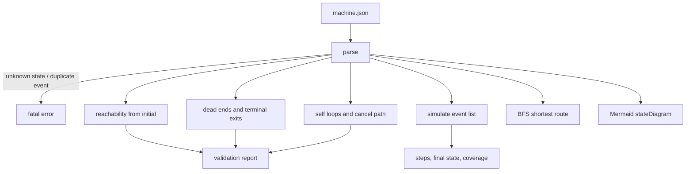
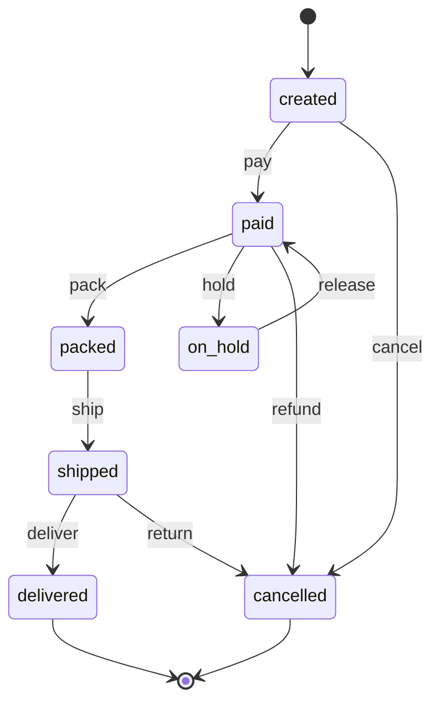

# Workflow-State-Machine

[](https://github.com/abubakarsiddique360/Workflow-State-Machine/actions/workflows/ci.yml)


Describe a workflow as states and events in JSON, then ask the questions that actually matter
before you ship it: can a record get stuck, is any state unreachable, does "done" still accept
events, and which path reaches a given status fastest. It also prints a Mermaid state diagram you
can paste into a design doc.

```text
created --pay--> paid --pack--> packed --ship--> shipped --deliver--> delivered
```

## Why it exists

Order statuses, ticket lifecycles and approval chains are finite state machines that usually exist
only as a `status` string in a database and a handful of `if` statements. That is fine until
someone adds a status that nothing can reach, a "finished" record that can still be edited, or an
`on_hold` state with no way out. The definition is small enough to review; this tool checks it
mechanically and draws it.

## How it works



## Install

```bash
pip install -e .
```

Python 3.10+, zero runtime dependencies.

## Usage

```bash
workflow-fsm validate examples/order-fulfilment.json            # reachability and sanity checks
workflow-fsm validate examples/leaky-process.json --markdown    # report with a Mermaid diagram
workflow-fsm run      examples/order-fulfilment.json --events pay,pack,ship,deliver
workflow-fsm run      examples/order-fulfilment.json --events release --from on_hold
workflow-fsm path     examples/order-fulfilment.json --to cancelled
workflow-fsm graph    examples/order-fulfilment.json            # Mermaid state diagram
workflow-fsm states   examples/order-fulfilment.json            # one line per state
```

Events can be separated with commas or `>`: `--events "pay > pack > ship"`.
Exit codes: `0` fine, `1` validation errors or a rejected run, `2` the definition cannot be read.

## The definition format

```json
{
  "name": "Order fulfilment",
  "initial": "created",
  "states": [
    { "name": "created" },
    { "name": "paid" },
    { "name": "delivered", "terminal": true }
  ],
  "transitions": [
    { "from": "created", "event": "pay", "to": "paid" },
    { "from": "paid", "event": "deliver", "to": "delivered" }
  ]
}
```

Fatal problems are rejected at parse time because they make the machine ambiguous:

| Fatal | Why |
| --- | --- |
| duplicate state name | two meanings for one name |
| `initial` not declared | no starting point |
| transition pointing at an unknown state | a typo silently creates a ghost state |
| two transitions with the same `from` and `event` | non-deterministic next state |

## Validation checks

| Code | Severity | Meaning |
| --- | --- | --- |
| `no-transitions` | error | The machine has no transitions at all. |
| `dead-end` | error | A non-terminal state has no outgoing transition, so records get stuck there. |
| `terminal-unreachable` | error | No terminal state can be reached from `initial`. |
| `unreachable-state` | warning | A declared state cannot be reached from `initial`. |
| `terminal-with-exit` | warning | A terminal state still has outgoing transitions, so "done" is ambiguous. |
| `unreachable-terminal` | warning | Some terminal states can never be reached. |
| `no-terminal` | warning | Nothing is marked terminal. |
| `self-loop` | note | A transition that returns to its own state. |
| `no-cancel-path` | note | No event contains `cancel`, which is often an oversight. |

`validate` exits `1` when any **error** is present; warnings and notes are informational.

## Example output

```text
$ workflow-fsm validate examples/leaky-process.json
Leaky review process  -  5 state(s), 4 transition(s)
initial 'draft'   terminal: approved

States
  draft                   events: submit
  review                  events: approve, retry
  approved      terminal  events: archive
  archived                events: -
  orphan                  events: -

Validation (2 error, 2 warning, 2 note)
  error   dead-end              state 'archived' is not terminal but has no outgoing transition
  error   dead-end              state 'orphan' is not terminal but has no outgoing transition
  warning unreachable-state     state 'orphan' cannot be reached from 'draft'
  warning terminal-with-exit    terminal state 'approved' still has outgoing transitions
  note    self-loop             self transition 'review:retry' never changes state
  note    no-cancel-path        no transition uses a 'cancel' style event
```

```text
$ workflow-fsm run examples/order-fulfilment.json --events pay,pack,ship,deliver
Order fulfilment
Run from 'created' with 4 event(s)
   1. pay          created -> paid
   2. pack         paid -> packed
   3. ship         packed -> shipped
   4. deliver      shipped -> delivered
  final state 'delivered' (terminal)
  transition coverage 44%
```

A rejected event names the state and what it would have accepted:

```text
$ workflow-fsm run examples/order-fulfilment.json --events ship
rejected at step 1: event 'ship' is not accepted in 'created' (available: pay, cancel)
```

## The generated diagram

`workflow-fsm graph` (and `validate --markdown`) prints a `stateDiagram-v2` block. For the sample
machine it is exactly:



## Design notes

- **Breadth-first search for routes.** `path` reports the fewest events to reach a state, which is
  what people mean by "the shortest way to cancel". States are visited once, so it terminates on
  cyclic graphs.
- **Validation is separate from simulation.** A machine may be perfectly runnable and still be
  wrong, so `run` never fails because of a warning and `validate` never depends on a run.
- **Coverage, not guesswork.** Every run reports which of the declared transitions it exercised, so
  a test suite can grow until it covers the graph.
- **Rejections carry context.** An invalid event lists the events that *were* available in that
  state, which turns a failed run into a usable error message.
- **Deterministic output.** States and transitions keep file order, so reports and diffs stay stable.

## Project layout

```text
src/workflow_state_machine/
  machine.py   JSON parsing and structural validation
  analysis.py  reachability, dead ends, terminal exits, self loops, problem list
  runner.py    simulation, coverage, BFS shortest path, unexplored events
  report.py    text, markdown with Mermaid, JSON
  cli.py       validate / run / path / graph / states
examples/
  order-fulfilment.json  a sound machine with two terminals
  leaky-process.json     an intentionally broken machine
tests/                   80 tests across parsing, analysis, simulation and the CLI
```

## Development

```bash
python -m pip install -e ".[dev]"
python -m pytest
python -m ruff check .
python -m ruff format --check .
```

CI runs the suite on Python 3.10 and 3.12, checks formatting, then validates, runs, routes and draws
the sample machines.

## Limitations

- Classic deterministic machines only: no hierarchical states, parallel regions, guards, actions or
  timers. A guard can be described in `note` but is never evaluated.
- Event sequences are given explicitly; the tool does not generate test sequences for full coverage.
- `path` optimises for the fewest events, not for a preferred or cheapest route.
- The JSON is the source of truth; there is no exporter to a framework specific dialect.

## License

MIT, copyright (c) 2026 ABU BAKAR SIDDIQUE.
